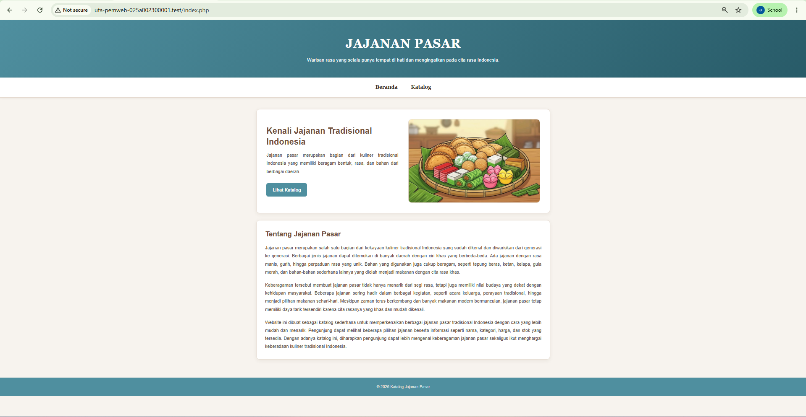
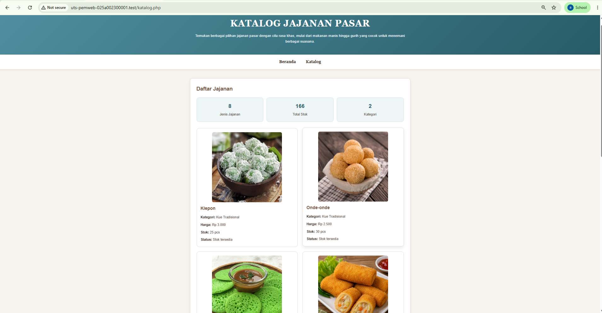
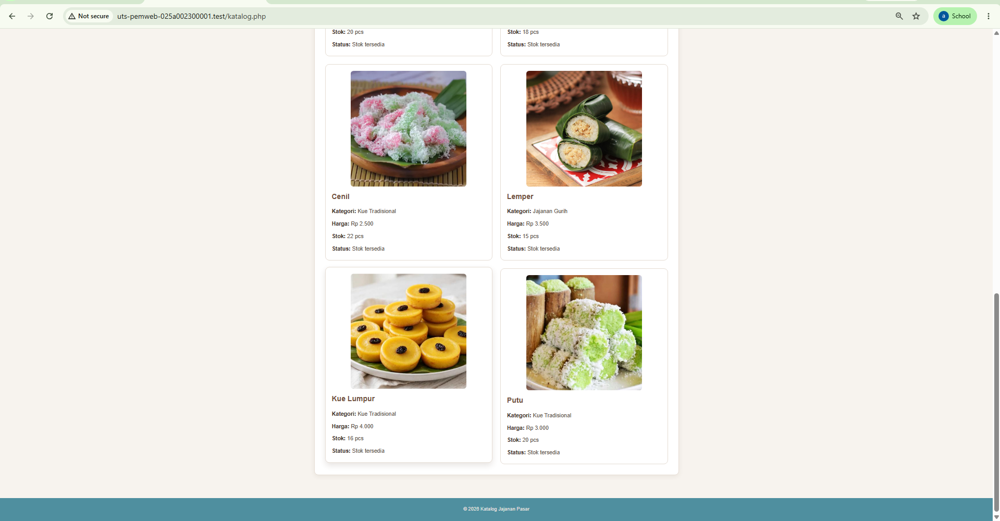

# uts-pemweb-025A00230001

## 1. Identitas

- **Nama:** Ananda Eka Cahya
- **NIM:** 025A00230001
- **Kelas:** 2A-3A
- **Mata Kuliah:** Pemrograman Web
- **Program Studi:** Informatika
- **Tema:** Jajanan Pasar

---

## 2. Deskripsi Proyek

Project ini merupakan website sederhana yang dibuat untuk memenuhi tugas UTS Pemrograman Web dengan tema **Jajanan Pasar**.

Website digunakan untuk menampilkan informasi dan katalog jajanan pasar  yang dilengkapi dengan nama, kategori, harga, dan stok. Data jajanan disimpan menggunakan array PHP dan ditampilkan pada halaman katalog.

Project dibuat menggunakan HTML, CSS, dan PHP sesuai dengan materi yang telah dipelajari dan belum menggunakan database.

---

## 3. Cara Menjalankan di Localhost

Project dijalankan menggunakan Laragon.

### Langkah Menjalankan

1. Pastikan Laragon sudah terpasang.
2. Letakkan folder project di dalam folder `www` Laragon.
3. Jalankan Laragon.
4. Klik **Start All**.
5. Buka browser.
6. Masukkan alamat berikut:
http://localhost/uts-pemweb-025A00230001/
7. Website akan menampilkan halaman utama.
8. Gunakan menu navigasi untuk berpindah ke halaman katalog.

---

## 4. Daftar Fitur
1. **Halaman Beranda** - `index.php` : Menampilkan informasi mengenai jajanan pasar serta navigasi ke Beranda dan Katalog.
2. **Halaman Katalog** - `katalog.php`: Menampilkan katalog jajanan pasar 
3. **Perulangan Data** -  `katalog.php` : Menggunakan `foreach` untuk menampilkan seluruh data dari $jajanan
4. **Format Harga Rupiah** - `functions.php` : Menggunakan fungsi `formatHarga()`untuk mengubah angka menjadi format seperti Rp 3.000
5. **Kondisi Stok** - `functions.php` : Menggunakan fungsi `statusStok()` untuk menampilkan status stok berdasarkan jumlah stok
6. **Ringkasan Data Katalog** - `katalog.php` : Menampilkan jumlah jenis jajanan, total stok, jumlah kategori 
7. **Navigasi antarhalaman** - `index.php`, `katalog.php`: Memudahkan perpindahan antara halaman Beranda dan Katalog
8. **Tampilan Responsif** -  `style.css` : Tampilan menyesuaikan ukuran desktop, tablet, serta HP menggunakan `@media`
9. **Keamanan Output** - `katalog.php` : Menggunakan `htmlspecialchars()` saat menampilkan data agar output lebih aman

### Fungsi Buatan Sendiri
Fungsi buatan sendiri digunakan untuk membantu mengolah data dan menampilkan hasil pada halaman website.
1. `formatHarga()` - `int $harga` : Mengubah angka harga menjadi format rupiah|
2. `statusStok()` - `int $stok` : Menentukan status stok berdasarkan jumlah stok. Jika stok ≤ 5, menampilkan Stok sedikit, selain itu Stok tersedia

---

## 5. Fungsi Array Bawaan PHP
1.  `count()` :  Menghitung jumlah data jajanan dan jumlah kategori
2. `array_column()` : Mengambil nilai dari kolom tertentu dari array seperti stok dan kategori
3. `array_sum()` : Menjumlahkan nilai dalam array
4. `array_unique()` : Menghilangkan data kategori yang sama untuk mendapatkan jumlah kategori yang berbeda

---

## 6. Tangkapan Layar

### 6.1 Halaman Profil

### 6.2 Halaman Katalog

---

## 7. Sumber Referensi dan Catatan Pemakaian AI

### Sumber Referensi
 Materi dari contoh yang diberikan pada perkuliahan Pemrograman Web 

### Catatan Pemakaian AI
1. Membantu memahami cara menggunakan Git dan GitHub dan cara melakukan git add, git commit, dan git push.
2. Membantu memberikan saran untuk tampilan dan penyesuaian CSS agar website lebih rapi dan responsif.
3. Membantu memahami beberapa fungsi dan konsep HTML, CSS, serta PHP yang digunakan dalam project.

---